# Arquitectura de la Aplicación

## Resumen Ejecutivo

GanaderaSoft es una aplicación web para la gestión integral de operaciones ganaderas, desarrollada con **Laravel 10** como framework backend y **API REST** para la comunicación con clientes. El sistema implementa un enfoque **offline-first** para garantizar la continuidad operativa en entornos rurales con conectividad limitada.

## Patrón Arquitectónico

### MVC (Model-View-Controller)

El sistema sigue el patrón **MVC** de Laravel, complementado con:

- **API-First Design**: Todas las funcionalidades se exponen a través de endpoints REST
- **Arquitectura por Capas**: Separación clara entre presentación, lógica de negocio y datos
- **Patrón Repository** (implícito en los modelos Eloquent)
- **Autenticación Stateless** con Laravel Sanctum

## Diagrama de Arquitectura General

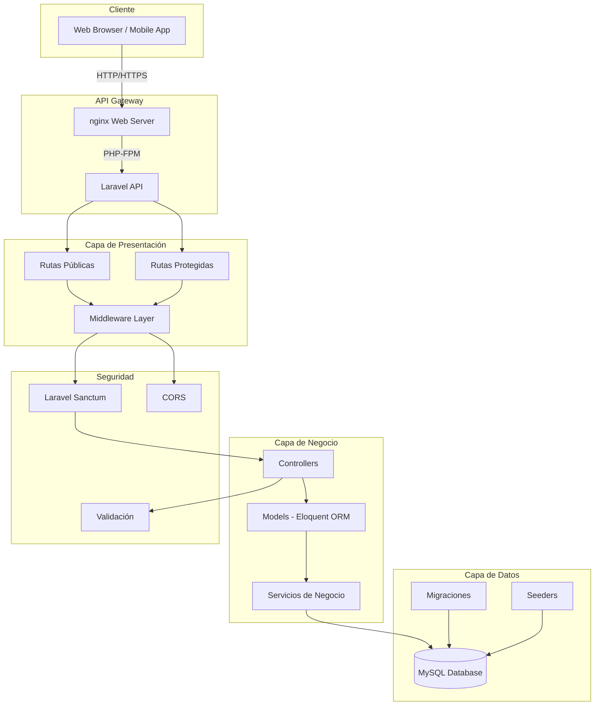

## Capas del Sistema

### 1. Capa de Presentación (API REST)

La capa de presentación expone todos los servicios a través de una API REST, sin renderizado de vistas HTML.

#### Diagrama de Rutas

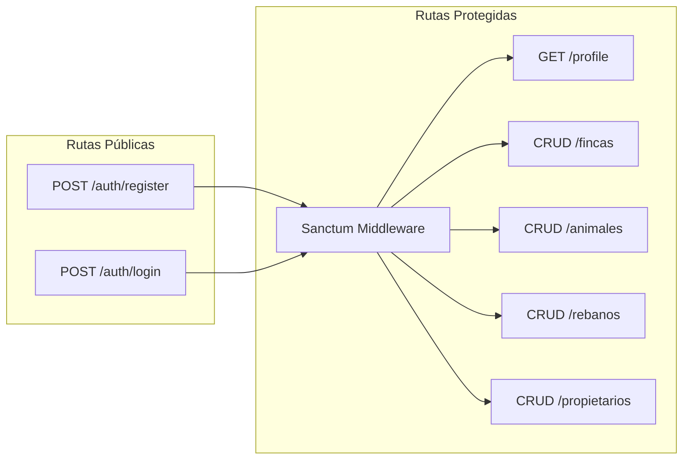

#### Controllers Principales

| Controller | Responsabilidad |
|-----------|----------------|
| `AuthController` | Autenticación (login, registro, logout) |
| `FincaController` | Gestión de fincas |
| `PropietarioController` | Gestión de propietarios |
| `RebanoController` | Gestión de rebaños |
| `AnimalController` | Gestión de animales |
| `InventarioBufaloController` | Gestión de inventarios de búfalos |
| `TipoAnimalController` | Gestión de tipos de animales |
| `ConfiguracionController` | Endpoints de configuración |
| `ComposicionRazaController` | Gestión de composición de razas |
| `EtapaController` | Gestión de etapas de vida |
| `PersonalFincaController` | Gestión de personal de fincas |
| `PesoCorporalController` | Registro de pesos corporales |
| `MedidasCorporalesController` | Medidas corporales de animales |
| `LactanciaController` | Control de lactancia |
| `LecheController` | Producción de leche |

### 2. Capa de Middleware

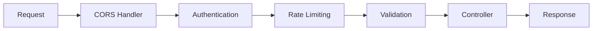

#### Middlewares Implementados

- **CORS Handling**: Permite peticiones cross-origin
- **Authentication (Sanctum)**: Verifica tokens de autenticación
- **Rate Limiting**: Previene abuso de la API
- **Validation**: Valida datos de entrada

### 3. Capa de Lógica de Negocio

#### Diagrama de Modelos Principales

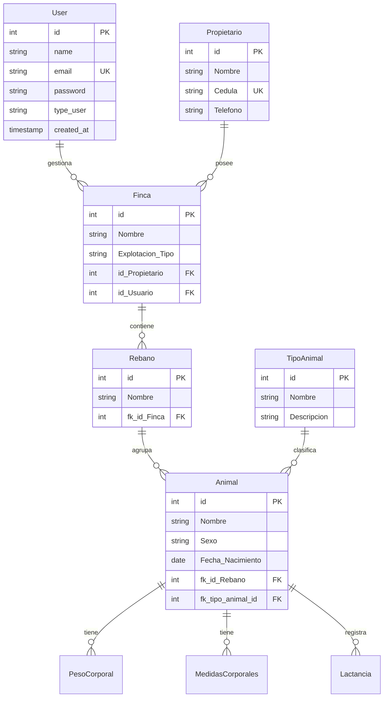

#### Relaciones entre Modelos

**One-to-Many:**
- User → Fincas
- Propietario → Fincas
- Finca → Rebaños
- Rebano → Animales
- Animal → PesosCorporales
- Animal → MedidasCorporales
- Animal → Lactancias

**Many-to-Many:**
- Animal ↔ Etapa (a través de `etapa_animal`)

**BelongsTo:**
- Finca → User
- Finca → Propietario
- Rebano → Finca
- Animal → Rebano
- Animal → TipoAnimal

### 4. Capa de Datos

#### Estructura de Base de Datos

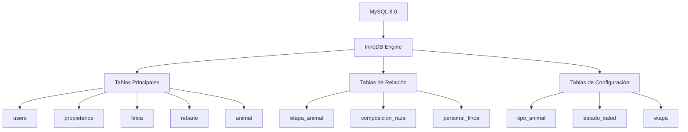

## Patrones de Diseño Implementados

### 1. Repository Pattern (Eloquent)

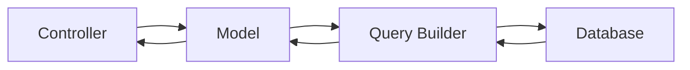

### 2. Factory Pattern

Utilizado para la creación de instancias de prueba:

```php
// database/factories/UserFactory.php
// database/factories/FincaFactory.php
```

### 3. Middleware Pattern

Pipeline de procesamiento de requests:

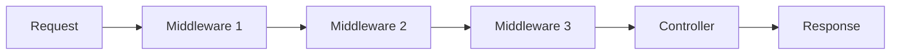

### 4. Service Provider Pattern

Inyección de dependencias y bootstrapping de la aplicación.

## Flujo de Autenticación

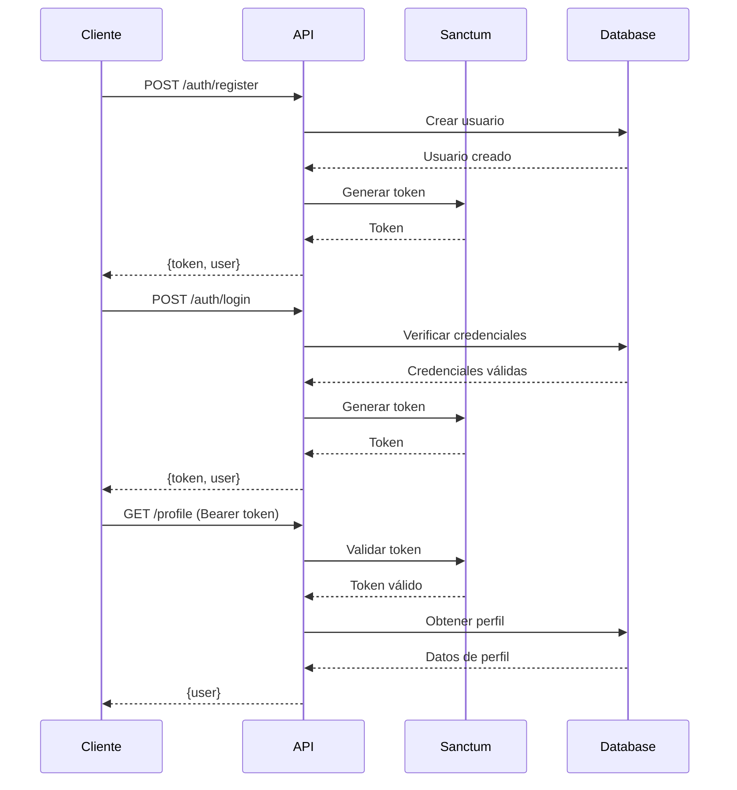

## Flujo de Request CRUD

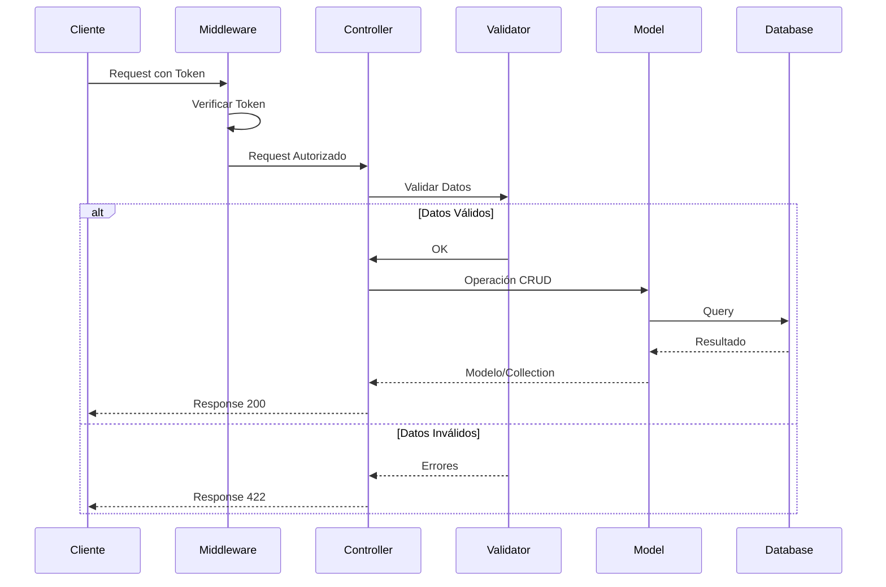

## Estrategia Offline-First

### Sincronización de Datos

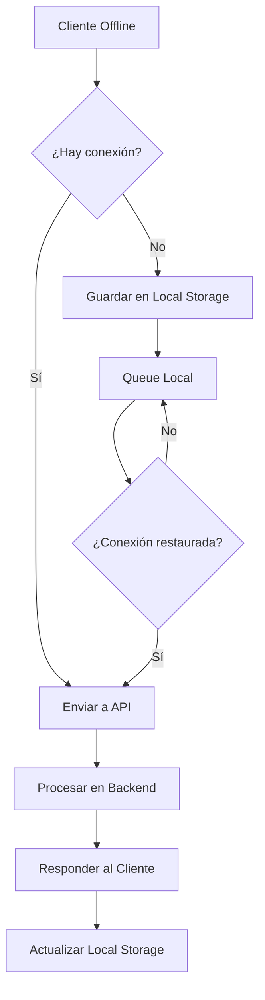

### Características Offline-First

1. **Almacenamiento Local**: IndexedDB o LocalStorage
2. **Queue de Sincronización**: Cola de operaciones pendientes
3. **Conflict Resolution**: Estrategia Last-Write-Wins
4. **Timestamps**: Control de versiones mediante `created_at` y `updated_at`

## Escalabilidad y Performance

### Optimizaciones Implementadas

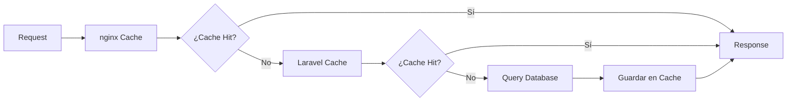

### Estrategias de Escalabilidad

1. **Paginación**: Todos los listados paginados (15 items por página)
2. **Eager Loading**: Carga anticipada de relaciones
3. **Índices de Base de Datos**: En columnas de búsqueda frecuente
4. **Query Optimization**: Evitar N+1 queries
5. **Caché de Configuración**: Datos estáticos en archivos JSON

## Seguridad

### Capas de Seguridad

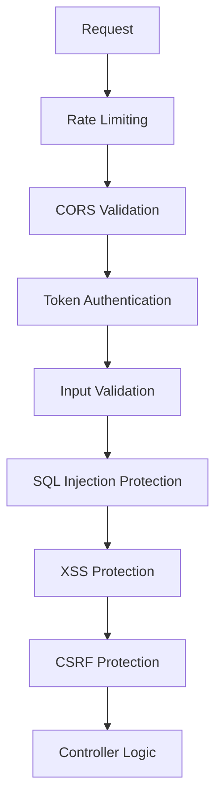

### Medidas de Seguridad Implementadas

1. **Autenticación**: Laravel Sanctum con tokens Bearer
2. **Validación de Entrada**: Request validation en todos los endpoints
3. **Protección CSRF**: Para requests que modifican estado
4. **Rate Limiting**: Límite de requests por IP
5. **SQL Injection**: Prevención mediante Eloquent ORM
6. **Password Hashing**: bcrypt con salts automáticos
7. **HTTPS**: Recomendado para producción

## Deployment y DevOps

### Arquitectura de Contenedores

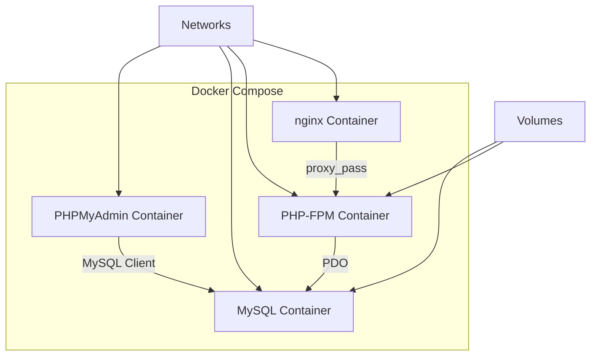

### Pipeline de Deployment (Planificado)

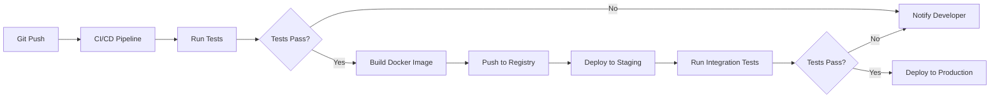

## Monitoreo y Logging

### Sistema de Logs

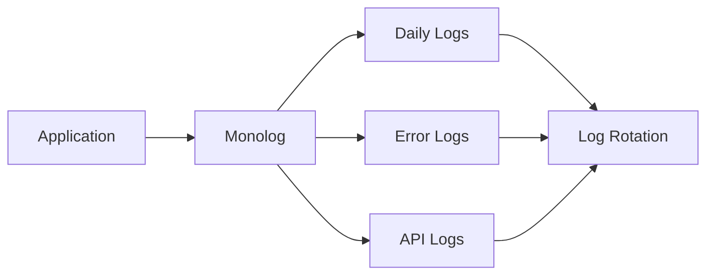

### Niveles de Log

- **DEBUG**: Información detallada de debugging
- **INFO**: Eventos informativos
- **WARNING**: Advertencias que no son errores
- **ERROR**: Errores de runtime
- **CRITICAL**: Condiciones críticas

## Módulos del Sistema

### Módulos Core

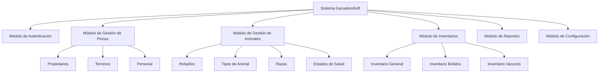

## Interacción entre Módulos

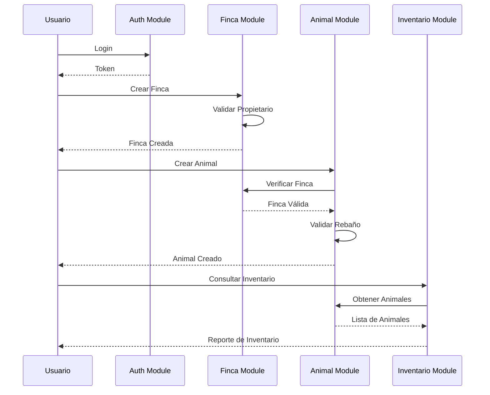

## Roadmap de Arquitectura

### Fase 1 (Actual)
- [x] API REST básica
- [x] Autenticación con Sanctum
- [x] CRUD de entidades principales
- [x] Base de datos relacional

### Fase 2 (Planificada)
- [ ] WebSockets para notificaciones en tiempo real
- [ ] Sistema de cache distribuido (Redis)
- [ ] Queue workers para tareas pesadas
- [ ] API Gateway con rate limiting avanzado

### Fase 3 (Futura)
- [ ] Microservicios
- [ ] Event Sourcing
- [ ] CQRS Pattern
- [ ] GraphQL API

## Conclusión

La arquitectura de GanaderaSoft está diseñada para ser:

- **Escalable**: Fácil de escalar horizontalmente
- **Mantenible**: Código organizado y bien documentado
- **Segura**: Múltiples capas de seguridad
- **Performante**: Optimizaciones en todos los niveles
- **Resiliente**: Estrategia offline-first
- **Extensible**: Fácil de agregar nuevas funcionalidades

---

**Última actualización:** Octubre 2025  
**Mantenido por:** Equipo de Desarrollo GanaderaSoft
