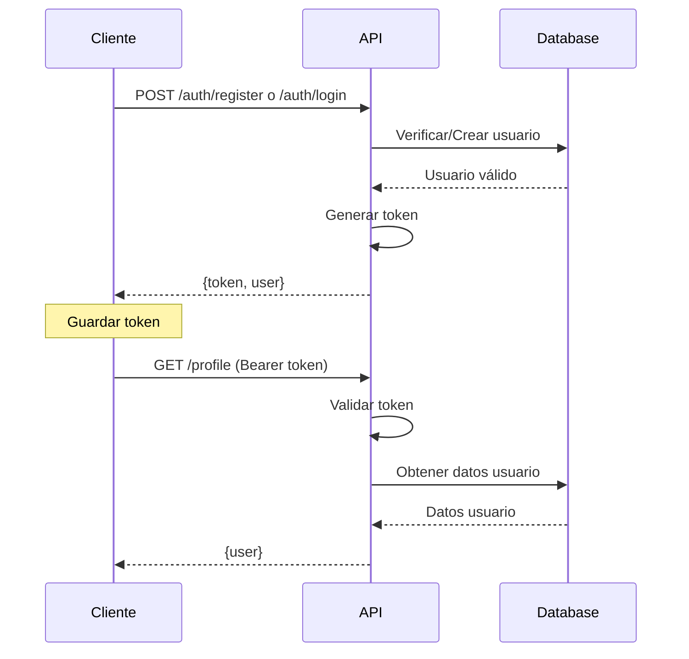

# API y Servicios

## Descripción General

La API de GanaderaSoft es una **API REST** que utiliza JSON para el intercambio de datos. Todos los endpoints siguen los estándares HTTP y utilizan autenticación basada en tokens Bearer (Laravel Sanctum).

## Configuración Inicial

### URL Base

```
http://localhost:8000/api
```

**Producción:**
```
https://api.ganaderasoft.com/api
```

### Headers Requeridos

Para todos los requests:

```http
Content-Type: application/json
Accept: application/json
```

Para endpoints protegidos (🔒):

```http
Authorization: Bearer {token}
```

## Autenticación

### Sistema de Autenticación

La API utiliza **Laravel Sanctum** para autenticación basada en tokens:

- **Tipo**: Bearer Token
- **Duración**: Tokens permanentes hasta revocación manual
- **Seguridad**: Tokens hasheados en base de datos
- **Renovación**: Login genera nuevo token

### Flujo de Autenticación



## Endpoints de Autenticación

### POST `/auth/register`

Registra un nuevo usuario en el sistema.

**Campos Requeridos:**

```json
{
  "name": "string (máx. 255 caracteres)",
  "email": "string (email válido, único)",
  "password": "string (mín. 8 caracteres)",
  "password_confirmation": "string (debe coincidir con password)",
  "type_user": "string (admin|propietario|tecnico)"
}
```

**Respuesta Exitosa (201):**

```json
{
  "success": true,
  "message": "Usuario registrado exitosamente",
  "data": {
    "user": {
      "id": 1,
      "name": "Juan Pérez",
      "email": "juan@example.com",
      "type_user": "propietario",
      "created_at": "2025-10-14T10:00:00.000000Z"
    },
    "token": "1|AbCdEfGhIjKlMnOpQrStUvWxYz",
    "token_type": "Bearer"
  }
}
```

### POST `/auth/login`

Autentica un usuario y devuelve un token de acceso.

**Campos Requeridos:**

```json
{
  "email": "string",
  "password": "string"
}
```

**Respuesta Exitosa (200):**

```json
{
  "success": true,
  "message": "Login exitoso",
  "data": {
    "user": {
      "id": 1,
      "name": "Juan Pérez",
      "email": "juan@example.com",
      "type_user": "propietario"
    },
    "token": "2|XyZ123456789AbCdEfGhIjKlMn",
    "token_type": "Bearer"
  }
}
```

### GET `/profile` 🔒

Obtiene el perfil del usuario autenticado.

**Headers:**
```http
Authorization: Bearer {token}
```

**Respuesta Exitosa (200):**

```json
{
  "success": true,
  "data": {
    "id": 1,
    "name": "Juan Pérez",
    "email": "juan@example.com",
    "type_user": "propietario",
    "created_at": "2025-10-14T10:00:00.000000Z"
  }
}
```

### POST `/auth/logout` 🔒

Cierra sesión y revoca el token actual.

**Respuesta Exitosa (200):**

```json
{
  "success": true,
  "message": "Logout exitoso"
}
```

## Endpoints de Gestión

### Propietarios

#### GET `/propietarios` 🔒

Lista todos los propietarios con paginación.

**Query Parameters:**
- `page` (opcional): Número de página (default: 1)
- `per_page` (opcional): Items por página (default: 15)

**Respuesta (200):**

```json
{
  "success": true,
  "data": {
    "current_page": 1,
    "data": [
      {
        "id": 1,
        "Nombre": "Pedro González",
        "Cedula": "12345678",
        "Telefono": "3001234567",
        "created_at": "2025-10-14T10:00:00.000000Z"
      }
    ],
    "total": 50,
    "per_page": 15
  }
}
```

#### POST `/propietarios` 🔒

Crea un nuevo propietario.

**Campos Requeridos:**

```json
{
  "Nombre": "string (máx. 100 caracteres)",
  "Cedula": "string (único, máx. 20 caracteres)",
  "Telefono": "string (opcional, máx. 15 caracteres)"
}
```

#### GET `/propietarios/{id}` 🔒

Obtiene un propietario específico con sus fincas.

#### PUT `/propietarios/{id}` 🔒

Actualiza un propietario existente.

#### DELETE `/propietarios/{id}` 🔒

Elimina un propietario (soft delete).

### Fincas

#### GET `/fincas` 🔒

Lista todas las fincas del usuario autenticado.

**Respuesta (200):**

```json
{
  "success": true,
  "data": [
    {
      "id": 1,
      "Nombre": "Finca El Paraíso",
      "Explotacion_Tipo": "Intensiva",
      "Area_Total": "50.5",
      "id_Propietario": 1,
      "propietario": {
        "id": 1,
        "Nombre": "Pedro González"
      },
      "rebanos_count": 3
    }
  ]
}
```

#### POST `/fincas` 🔒

Crea una nueva finca.

**Campos Requeridos:**

```json
{
  "Nombre": "string (máx. 100 caracteres)",
  "Explotacion_Tipo": "string (Intensiva|Extensiva|Compuesta|Otro)",
  "Area_Total": "decimal (opcional)",
  "id_Propietario": "integer (ID del propietario)",
  "Direccion": "string (opcional)",
  "Vereda": "string (opcional)",
  "Municipio": "string (opcional)",
  "Departamento": "string (opcional)"
}
```

#### GET `/fincas/{id}` 🔒

Obtiene una finca específica con sus relaciones.

**Respuesta (200):**

```json
{
  "success": true,
  "data": {
    "id": 1,
    "Nombre": "Finca El Paraíso",
    "propietario": {
      "id": 1,
      "Nombre": "Pedro González"
    },
    "rebanos": [
      {
        "id": 1,
        "Nombre": "Rebaño Principal"
      }
    ],
    "terreno": {
      "id": 1,
      "Area_Total": "50.5",
      "Tipo_Relieve": "Plano"
    }
  }
}
```

#### PUT `/fincas/{id}` 🔒

Actualiza una finca existente.

#### DELETE `/fincas/{id}` 🔒

Archiva una finca (soft delete).

### Rebaños

#### GET `/rebanos` 🔒

Lista todos los rebaños del usuario.

**Query Parameters:**
- `finca_id` (opcional): Filtrar por finca

#### POST `/rebanos` 🔒

Crea un nuevo rebaño.

**Campos Requeridos:**

```json
{
  "Nombre": "string (máx. 100 caracteres)",
  "fk_id_Finca": "integer (ID de la finca)",
  "Descripcion": "string (opcional)"
}
```

#### GET `/rebanos/{id}` 🔒

Obtiene un rebaño con sus animales.

#### PUT `/rebanos/{id}` 🔒

Actualiza un rebaño.

#### DELETE `/rebanos/{id}` 🔒

Elimina un rebaño.

### Animales

#### GET `/animales` 🔒

Lista todos los animales.

**Query Parameters:**
- `rebano_id` (opcional): Filtrar por rebaño
- `tipo_animal_id` (opcional): Filtrar por tipo
- `sexo` (opcional): M o H

**Respuesta (200):**

```json
{
  "success": true,
  "data": {
    "data": [
      {
        "id": 1,
        "Nombre": "Luna",
        "Sexo": "H",
        "Fecha_Nacimiento": "2023-01-15",
        "edad_meses": 21,
        "rebano": {
          "id": 1,
          "Nombre": "Rebaño Principal"
        },
        "tipo_animal": {
          "id": 1,
          "Nombre": "Búfalo"
        }
      }
    ]
  }
}
```

#### POST `/animales` 🔒

Crea un nuevo animal.

**Campos Requeridos:**

```json
{
  "Nombre": "string (máx. 100 caracteres)",
  "Sexo": "string (M|H)",
  "Fecha_Nacimiento": "date (YYYY-MM-DD)",
  "fk_id_Rebano": "integer",
  "fk_tipo_animal_id": "integer",
  "Numero_Identificacion": "string (único, opcional)",
  "Color": "string (opcional)",
  "Observaciones": "text (opcional)"
}
```

#### GET `/animales/{id}` 🔒

Obtiene un animal con todas sus relaciones.

**Respuesta (200):**

```json
{
  "success": true,
  "data": {
    "id": 1,
    "Nombre": "Luna",
    "edad_meses": 21,
    "pesos_corporales": [
      {
        "id": 1,
        "Peso": "450.5",
        "Fecha_Peso": "2025-10-01"
      }
    ],
    "medidas_corporales": [],
    "lactancias": [],
    "etapas": [
      {
        "id": 1,
        "Nombre": "Adulto"
      }
    ]
  }
}
```

#### PUT `/animales/{id}` 🔒

Actualiza un animal.

#### DELETE `/animales/{id}` 🔒

Elimina un animal.

### Inventarios

#### GET `/inventario-bufalo` 🔒

Obtiene el inventario de búfalos.

**Query Parameters:**
- `finca_id` (opcional): Filtrar por finca
- `fecha_inicio` (opcional): Fecha desde
- `fecha_fin` (opcional): Fecha hasta

#### POST `/inventario-bufalo` 🔒

Registra un nuevo inventario de búfalos.

### Tipos de Animal

#### GET `/tipos-animal` 🔒

Lista todos los tipos de animales.

**Respuesta (200):**

```json
{
  "success": true,
  "data": [
    {
      "id": 1,
      "Nombre": "Búfalo",
      "Descripcion": "Búfalo de agua"
    },
    {
      "id": 2,
      "Nombre": "Vacuno",
      "Descripcion": "Ganado vacuno"
    }
  ]
}
```

## Endpoints de Configuración

Estos endpoints devuelven datos de configuración estáticos desde archivos JSON.

### GET `/configuracion/tipo-explotacion` 🔒

Tipos de explotación ganadera.

**Respuesta (200):**

```json
{
  "success": true,
  "data": [
    "Intensiva",
    "Extensiva",
    "Compuesta",
    "Otro"
  ]
}
```

### GET `/configuracion/metodo-riego` 🔒

Métodos de riego disponibles.

### GET `/configuracion/ph-suelo` 🔒

Valores de pH del suelo.

### GET `/configuracion/textura-suelo` 🔒

Texturas de suelo.

### GET `/configuracion/fuente-agua` 🔒

Fuentes de agua.

### GET `/configuracion/sexo` 🔒

Opciones de sexo para animales.

**Respuesta (200):**

```json
{
  "success": true,
  "data": ["M", "H"]
}
```

### GET `/configuracion/tipo-relieve` 🔒

Tipos de relieve del terreno.

## Endpoints de Relaciones Animales

### Peso Corporal

#### POST `/animales/{animal}/peso-corporal` 🔒

Registra un nuevo peso corporal.

**Campos Requeridos:**

```json
{
  "Peso": "decimal (kg)",
  "Fecha_Peso": "date (YYYY-MM-DD)",
  "Observaciones": "string (opcional)"
}
```

### Medidas Corporales

#### POST `/animales/{animal}/medidas-corporales` 🔒

Registra medidas corporales del animal.

**Campos Requeridos:**

```json
{
  "Altura_Cruz": "decimal (cm, opcional)",
  "Largo_Cuerpo": "decimal (cm, opcional)",
  "Perimetro_Toracico": "decimal (cm, opcional)",
  "Fecha_Medicion": "date"
}
```

### Lactancia

#### POST `/animales/{animal}/lactancia` 🔒

Registra un periodo de lactancia.

**Campos Requeridos:**

```json
{
  "Fecha_Inicio": "date",
  "Fecha_Fin": "date (opcional)",
  "Numero_Lactancia": "integer"
}
```

### Producción de Leche

#### POST `/lactancia/{lactancia}/leche` 🔒

Registra producción de leche.

**Campos Requeridos:**

```json
{
  "Fecha": "date",
  "Cantidad_AM": "decimal (litros, opcional)",
  "Cantidad_PM": "decimal (litros, opcional)",
  "Cantidad_Total": "decimal (litros)"
}
```

## Composición de Raza

### GET `/composicion-raza` 🔒

Lista composiciones de raza.

**Query Parameters:**
- `finca_id` (opcional): Filtrar por finca
- `tipo_animal_id` (opcional): Filtrar por tipo de animal

### POST `/composicion-raza` 🔒

Crea una composición de raza.

**Campos Requeridos:**

```json
{
  "Nombre": "string",
  "Porcentaje": "decimal (0-100)",
  "fk_tipo_animal_id": "integer",
  "fk_id_Finca": "integer"
}
```

## Etapas

### GET `/etapas` 🔒

Lista todas las etapas de vida.

### POST `/etapas` 🔒 (Solo Admin)

Crea una nueva etapa.

**Campos Requeridos:**

```json
{
  "Nombre": "string (máx. 50 caracteres)",
  "Descripcion": "string (opcional)",
  "Edad_Minima_Meses": "integer",
  "Edad_Maxima_Meses": "integer (opcional)"
}
```

## Estados de Salud

### GET `/estados-salud` 🔒

Lista todos los estados de salud.

### POST `/estados-salud` 🔒

Crea un nuevo estado de salud.

## Personal de Finca

### GET `/personal-finca` 🔒

Lista el personal de las fincas.

### POST `/personal-finca` 🔒

Registra nuevo personal.

**Campos Requeridos:**

```json
{
  "Nombre": "string",
  "Cedula": "string (único)",
  "Cargo": "string",
  "fk_id_Finca": "integer"
}
```

## Códigos de Respuesta HTTP

| Código | Descripción | Uso |
|--------|-------------|-----|
| 200 | OK | Request exitoso |
| 201 | Created | Recurso creado exitosamente |
| 204 | No Content | Eliminación exitosa |
| 400 | Bad Request | Request mal formado |
| 401 | Unauthorized | Token inválido o faltante |
| 403 | Forbidden | Sin permisos suficientes |
| 404 | Not Found | Recurso no encontrado |
| 422 | Unprocessable Entity | Errores de validación |
| 500 | Internal Server Error | Error del servidor |

## Formato de Errores

### Error de Validación (422)

```json
{
  "message": "The given data was invalid.",
  "errors": {
    "email": [
      "El campo email es obligatorio."
    ],
    "password": [
      "El password debe tener al menos 8 caracteres."
    ]
  }
}
```

### Error de Autenticación (401)

```json
{
  "message": "Unauthenticated."
}
```

### Error No Encontrado (404)

```json
{
  "success": false,
  "message": "Finca no encontrada"
}
```

### Error del Servidor (500)

```json
{
  "success": false,
  "message": "Error interno del servidor",
  "error": "Descripción del error (solo en desarrollo)"
}
```

## Rate Limiting

La API implementa rate limiting para prevenir abuso:

- **Límite**: 60 requests por minuto por IP
- **Header de respuesta**: `X-RateLimit-Limit`, `X-RateLimit-Remaining`
- **Respuesta al exceder límite (429)**:

```json
{
  "message": "Too Many Attempts."
}
```

## Paginación

Los endpoints que retornan listas incluyen paginación automática:

```json
{
  "current_page": 1,
  "data": [...],
  "first_page_url": "http://localhost:8000/api/fincas?page=1",
  "from": 1,
  "last_page": 4,
  "last_page_url": "http://localhost:8000/api/fincas?page=4",
  "next_page_url": "http://localhost:8000/api/fincas?page=2",
  "path": "http://localhost:8000/api/fincas",
  "per_page": 15,
  "prev_page_url": null,
  "to": 15,
  "total": 50
}
```

## Ejemplos de Uso

### Ejemplo 1: Registro y Creación de Finca

```bash
# 1. Registrar usuario
curl -X POST http://localhost:8000/api/auth/register \
  -H "Content-Type: application/json" \
  -d '{
    "name": "Juan Pérez",
    "email": "juan@example.com",
    "password": "password123",
    "password_confirmation": "password123",
    "type_user": "propietario"
  }'

# 2. Crear finca (usar token del paso anterior)
curl -X POST http://localhost:8000/api/fincas \
  -H "Authorization: Bearer {token}" \
  -H "Content-Type: application/json" \
  -d '{
    "Nombre": "Finca El Paraíso",
    "Explotacion_Tipo": "Intensiva",
    "id_Propietario": 1,
    "Area_Total": "50.5"
  }'
```

### Ejemplo 2: Listar Animales de un Rebaño

```bash
curl -X GET "http://localhost:8000/api/animales?rebano_id=1" \
  -H "Authorization: Bearer {token}" \
  -H "Accept: application/json"
```

### Ejemplo 3: Registrar Peso de Animal

```bash
curl -X POST http://localhost:8000/api/animales/1/peso-corporal \
  -H "Authorization: Bearer {token}" \
  -H "Content-Type: application/json" \
  -d '{
    "Peso": "455.5",
    "Fecha_Peso": "2025-10-14",
    "Observaciones": "Peso normal"
  }'
```

## Colección de Postman

Para facilitar el testing de la API, se proporciona una colección completa de Postman:

**Ubicación:** `/docs/GanaderaSoft-API-Complete.postman_collection.json`

**Características:**
- Todos los endpoints documentados
- Variables de entorno configurables
- Tests automatizados
- Ejemplos de requests y responses

## Documentación OpenAPI

**Ubicación:** `/openapi/ganaderasoft-api-v1.yaml`

La especificación OpenAPI 3.0 proporciona:
- Definición formal de todos los endpoints
- Esquemas de datos
- Ejemplos de uso
- Compatible con Swagger UI

## Notas Importantes

1. **Eliminación Suave**: Las fincas utilizan soft delete (no se eliminan físicamente)
2. **Relaciones Eager Loading**: Los endpoints incluyen relaciones relevantes automáticamente
3. **Validación Estricta**: Todos los campos son validados según reglas definidas
4. **Timestamps Automáticos**: `created_at` y `updated_at` gestionados automáticamente
5. **Transacciones**: Las operaciones críticas utilizan transacciones de base de datos

---

**Última actualización:** Octubre 2025  
**Versión de la API:** v1.0.0  
**Mantenido por:** Equipo de Desarrollo GanaderaSoft
