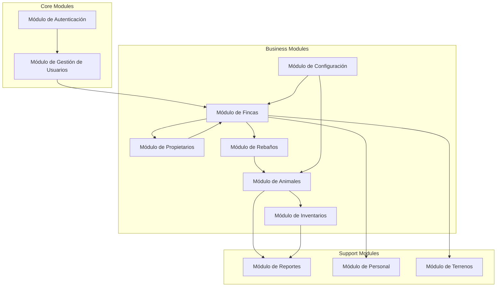
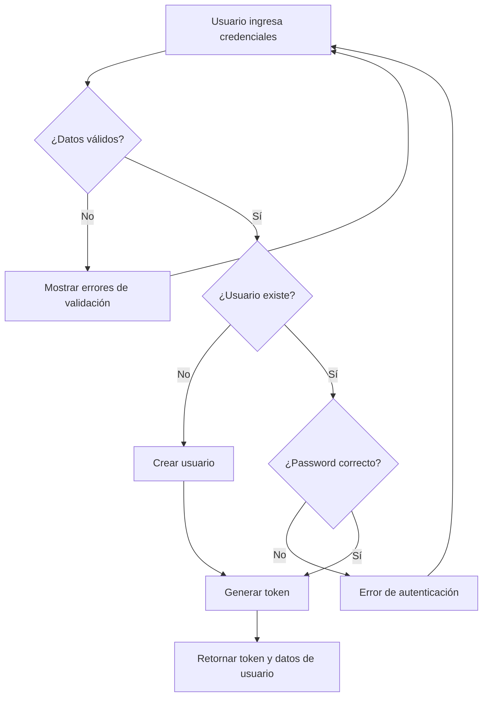
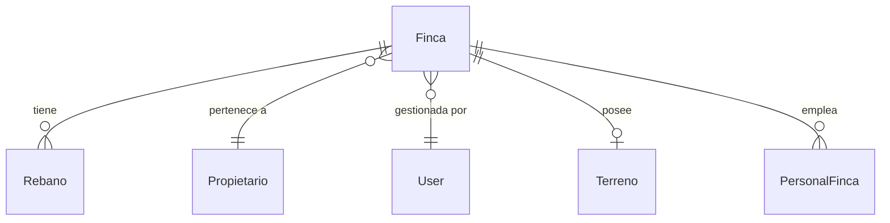
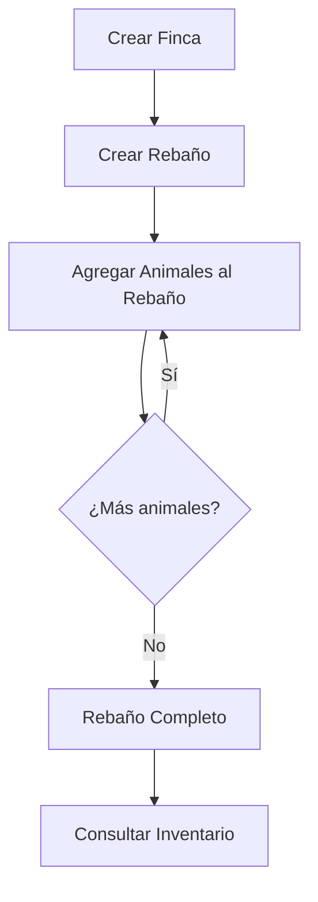
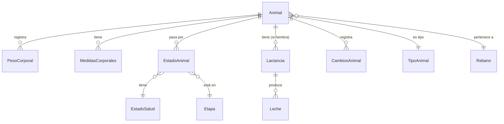
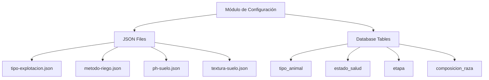
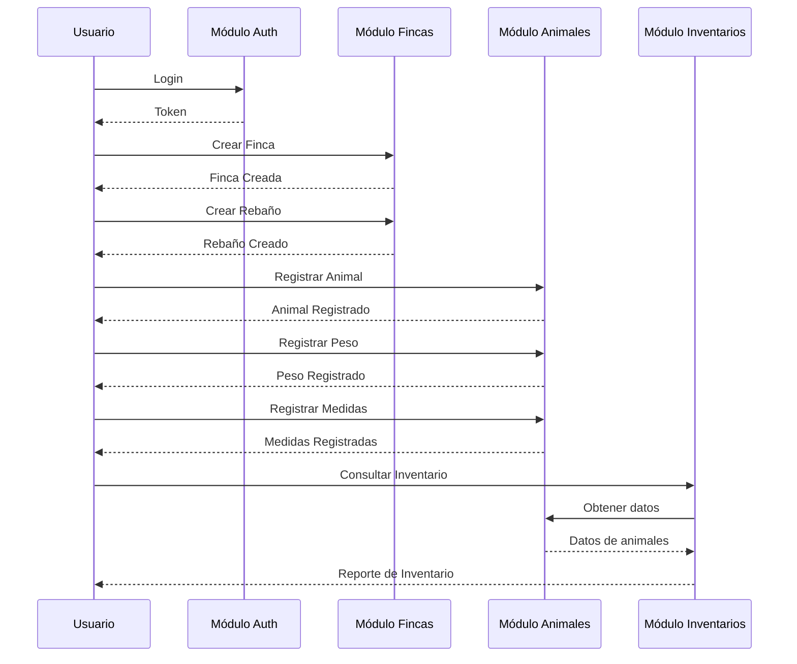
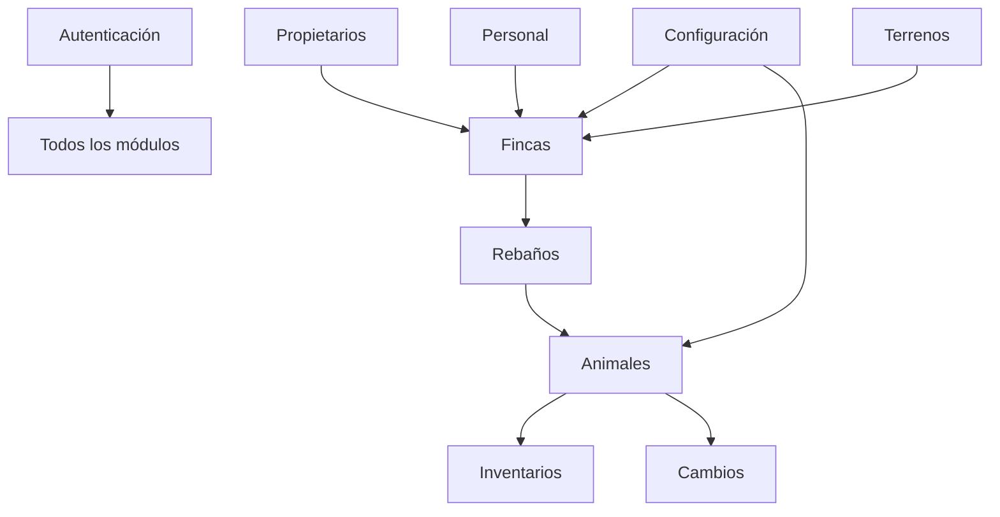

# Módulos y Funcionalidades

## Descripción General

GanaderaSoft está organizado en módulos funcionales que cubren todos los aspectos de la gestión ganadera. Cada módulo es independiente pero se integra perfectamente con los demás para proporcionar una solución completa.

## Arquitectura de Módulos



## 1. Módulo de Autenticación

### Descripción
Gestiona el acceso al sistema mediante autenticación basada en tokens.

### Funcionalidades

#### 1.1 Registro de Usuarios
- **Endpoint**: `POST /api/auth/register`
- **Funcionalidad**: Crear nuevos usuarios con validación de datos
- **Roles soportados**: admin, propietario, tecnico
- **Validaciones**:
  - Email único
  - Password mínimo 8 caracteres
  - Confirmación de password

#### 1.2 Inicio de Sesión
- **Endpoint**: `POST /api/auth/login`
- **Funcionalidad**: Autenticar usuario y generar token
- **Características**:
  - Token Bearer permanente
  - Hash seguro de passwords
  - Validación de credenciales

#### 1.3 Cierre de Sesión
- **Endpoint**: `POST /api/auth/logout`
- **Funcionalidad**: Revocar token activo
- **Seguridad**: Solo el usuario autenticado puede cerrar su sesión

#### 1.4 Perfil de Usuario
- **Endpoint**: `GET /api/profile`
- **Funcionalidad**: Obtener información del usuario autenticado
- **Datos incluidos**: nombre, email, tipo de usuario, fecha de creación

### Modelo de Datos

```php
User {
    id: integer
    name: string
    email: string (unique)
    password: string (hashed)
    type_user: enum(admin, propietario, tecnico)
    created_at: timestamp
    updated_at: timestamp
}
```

### Diagrama de Flujo



## 2. Módulo de Gestión de Fincas

### Descripción
Administra las propiedades ganaderas y sus características.

### Funcionalidades

#### 2.1 Listado de Fincas
- **Endpoint**: `GET /api/fincas`
- **Filtros**: Usuario propietario
- **Incluye**: Datos del propietario, conteo de rebaños
- **Paginación**: 15 items por página

#### 2.2 Creación de Finca
- **Endpoint**: `POST /api/fincas`
- **Campos requeridos**:
  - Nombre
  - Tipo de explotación
  - ID del propietario
- **Campos opcionales**:
  - Área total
  - Dirección
  - Vereda, Municipio, Departamento

#### 2.3 Detalle de Finca
- **Endpoint**: `GET /api/fincas/{id}`
- **Incluye**:
  - Datos del propietario
  - Lista de rebaños
  - Información de terreno
  - Personal asociado

#### 2.4 Actualización de Finca
- **Endpoint**: `PUT /api/fincas/{id}`
- **Validaciones**: Propietario debe existir

#### 2.5 Archivado de Finca
- **Endpoint**: `DELETE /api/fincas/{id}`
- **Tipo**: Soft delete
- **Nota**: No elimina físicamente los datos

### Modelo de Datos

```php
Finca {
    id: integer
    Nombre: string
    Explotacion_Tipo: enum(Intensiva, Extensiva, Compuesta, Otro)
    Area_Total: decimal
    Direccion: string
    Vereda: string
    Municipio: string
    Departamento: string
    id_Propietario: foreign_key
    id_Usuario: foreign_key
    deleted_at: timestamp (nullable)
    created_at: timestamp
    updated_at: timestamp
}
```

### Relaciones



## 3. Módulo de Propietarios

### Descripción
Gestiona la información de los dueños de las fincas.

### Funcionalidades

#### 3.1 Listado de Propietarios
- **Endpoint**: `GET /api/propietarios`
- **Paginación**: Automática
- **Ordenamiento**: Por nombre

#### 3.2 Creación de Propietario
- **Endpoint**: `POST /api/propietarios`
- **Validación**: Cédula única
- **Campos**: Nombre, Cédula, Teléfono

#### 3.3 Detalle de Propietario
- **Endpoint**: `GET /api/propietarios/{id}`
- **Incluye**: Lista de fincas asociadas

#### 3.4 Actualización y Eliminación
- **Endpoints**: `PUT /api/propietarios/{id}`, `DELETE /api/propietarios/{id}`

### Modelo de Datos

```php
Propietario {
    id: integer
    Nombre: string (max 100)
    Cedula: string (unique, max 20)
    Telefono: string (max 15)
    created_at: timestamp
    updated_at: timestamp
}
```

## 4. Módulo de Rebaños

### Descripción
Organiza los animales en grupos lógicos dentro de cada finca.

### Funcionalidades

#### 4.1 Gestión de Rebaños
- **Operaciones CRUD completas**
- **Filtrado**: Por finca
- **Relaciones**: Con finca y animales

#### 4.2 Asociación de Animales
- **Funcionalidad**: Asignar animales a rebaños
- **Validación**: Rebaño debe pertenecer a una finca válida

### Modelo de Datos

```php
Rebano {
    id: integer
    Nombre: string (max 100)
    Descripcion: text
    fk_id_Finca: foreign_key
    created_at: timestamp
    updated_at: timestamp
}
```

### Diagrama de Operaciones



## 5. Módulo de Animales

### Descripción
Módulo principal para la gestión individual de animales.

### Funcionalidades

#### 5.1 Registro de Animales
- **Endpoint**: `POST /api/animales`
- **Datos básicos**:
  - Nombre
  - Sexo (M/H)
  - Fecha de nacimiento
  - Tipo de animal
  - Rebaño
- **Datos opcionales**:
  - Número de identificación
  - Color
  - Observaciones

#### 5.2 Consulta de Animales
- **Endpoint**: `GET /api/animales`
- **Filtros disponibles**:
  - Por rebaño
  - Por tipo de animal
  - Por sexo
- **Incluye**: Edad calculada en meses

#### 5.3 Historial del Animal
- **Endpoint**: `GET /api/animales/{id}`
- **Información incluida**:
  - Pesos corporales
  - Medidas corporales
  - Etapas de vida
  - Lactancias (si aplica)
  - Estados de salud
  - Cambios registrados

#### 5.4 Actualización y Eliminación
- **Actualización**: Permite modificar datos básicos
- **Eliminación**: Elimina el animal y sus relaciones

### Modelo de Datos

```php
Animal {
    id: integer
    Nombre: string (max 100)
    Sexo: enum(M, H)
    Fecha_Nacimiento: date
    Numero_Identificacion: string (unique, nullable)
    Color: string
    Observaciones: text
    fk_id_Rebano: foreign_key
    fk_tipo_animal_id: foreign_key
    created_at: timestamp
    updated_at: timestamp
}
```

### Sub-funcionalidades

#### 5.5 Peso Corporal
- **Endpoint**: `POST /api/animales/{animal}/peso-corporal`
- **Registro**: Peso, fecha, observaciones
- **Uso**: Seguimiento de crecimiento

#### 5.6 Medidas Corporales
- **Endpoint**: `POST /api/animales/{animal}/medidas-corporales`
- **Medidas**:
  - Altura a la cruz
  - Largo del cuerpo
  - Perímetro torácico
- **Uso**: Evaluación morfológica

#### 5.7 Etapas de Vida
- **Endpoint**: `POST /api/animales/{animal}/estado-animal`
- **Funcionalidad**: Registrar etapa actual (cría, juvenil, adulto)
- **Validación**: Edad debe corresponder con la etapa

#### 5.8 Lactancia (Hembras)
- **Endpoint**: `POST /api/animales/{animal}/lactancia`
- **Registro**: Periodo de lactancia con fecha inicio/fin
- **Número**: Conteo de lactancias

#### 5.9 Producción de Leche
- **Endpoint**: `POST /lactancia/{lactancia}/leche`
- **Registro**: Cantidad AM, PM y total
- **Frecuencia**: Diaria

### Diagrama de Relaciones del Animal



## 6. Módulo de Inventarios

### Descripción
Gestión y control de inventarios de animales por categorías.

### Funcionalidades

#### 6.1 Inventario de Búfalos
- **Endpoint**: `GET /api/inventario-bufalo`
- **Filtros**: Por finca, fecha
- **Categorías**:
  - Machos por edad
  - Hembras por edad
  - Estado reproductivo

#### 6.2 Inventario General
- **Funcionalidad**: Resumen de todos los animales
- **Agrupación**: Por tipo de animal, sexo, edad

#### 6.3 Reportes de Inventario
- **Formatos**: JSON, CSV (futuro)
- **Datos**: Conteos, estadísticas, gráficas

### Modelo de Datos

```php
InventarioBufalo {
    id: integer
    fk_id_Finca: foreign_key
    Fecha_Inventario: date
    Machos_0_12_meses: integer
    Machos_12_24_meses: integer
    Machos_24_mas_meses: integer
    Hembras_0_12_meses: integer
    Hembras_12_24_meses: integer
    Hembras_24_mas_meses: integer
    Total_Animales: integer
    created_at: timestamp
}
```

## 7. Módulo de Configuración

### Descripción
Proporciona datos de configuración del sistema y catálogos.

### Funcionalidades

#### 7.1 Configuraciones Estáticas (JSON)
- **Tipo de Explotación**: Intensiva, Extensiva, Compuesta, Otro
- **Método de Riego**: Aspersión, Inundación, Goteo, etc.
- **pH de Suelo**: Valores de 1-14 con descripciones
- **Textura de Suelo**: Arcilla, Franco, Arenoso, etc.
- **Fuente de Agua**: Río, Pozo, Acueducto, etc.
- **Sexo**: M, H
- **Tipo de Relieve**: Plano, Ondulado, Montañoso, Otro

#### 7.2 Tipos de Animal
- **Endpoint**: `GET /api/tipos-animal`
- **Funcionalidad**: Lista tipos de animales (Búfalo, Vacuno, etc.)
- **CRUD completo**: Solo para admin

#### 7.3 Estados de Salud
- **Endpoint**: `GET /api/estados-salud`
- **Funcionalidad**: Catálogo de estados de salud
- **Uso**: Clasificación de estado de animales

#### 7.4 Etapas de Vida
- **Endpoint**: `GET /api/etapas`
- **Funcionalidad**: Etapas por rango de edad
- **Ejemplos**: Cría (0-12 meses), Juvenil (12-24), Adulto (24+)

#### 7.5 Composición de Raza
- **Endpoint**: `GET /api/composicion-raza`
- **Funcionalidad**: Porcentajes de razas en animales
- **Filtros**: Por finca, por tipo de animal

### Arquitectura de Configuración



## 8. Módulo de Personal de Finca

### Descripción
Gestión del personal que trabaja en las fincas.

### Funcionalidades

#### 8.1 Registro de Personal
- **Endpoint**: `POST /api/personal-finca`
- **Datos**: Nombre, Cédula, Cargo, Finca
- **Validación**: Cédula única

#### 8.2 Consulta de Personal
- **Endpoint**: `GET /api/personal-finca`
- **Filtros**: Por finca
- **Incluye**: Datos de la finca asociada

### Modelo de Datos

```php
PersonalFinca {
    id: integer
    Nombre: string
    Cedula: string (unique)
    Cargo: string
    Telefono: string
    fk_id_Finca: foreign_key
    created_at: timestamp
    updated_at: timestamp
}
```

## 9. Módulo de Terrenos

### Descripción
Información detallada sobre las características del terreno de cada finca.

### Funcionalidades

#### 9.1 Registro de Terreno
- **Asociación**: Una finca tiene un terreno
- **Datos**:
  - Área total
  - Tipo de relieve
  - pH de suelo
  - Textura de suelo
  - Método de riego
  - Fuente de agua

### Modelo de Datos

```php
Terreno {
    id: integer
    Area_Total: decimal
    Tipo_Relieve: string
    pH_Suelo: string
    Textura_Suelo: string
    Metodo_Riego: string
    Fuente_Agua: string
    fk_id_Finca: foreign_key (unique)
    created_at: timestamp
    updated_at: timestamp
}
```

## 10. Módulo de Cambios y Auditoría

### Descripción
Registro de cambios importantes en animales.

### Funcionalidades

#### 10.1 Registro de Cambios
- **Endpoint**: `POST /api/animales/{animal}/cambios`
- **Tipos de cambios**:
  - Cambio de rebaño
  - Cambio de estado
  - Cambio de finca
  - Venta/Compra
  - Muerte

#### 10.2 Historial de Cambios
- **Consulta**: Por animal
- **Incluye**: Fecha, tipo de cambio, observaciones

### Modelo de Datos

```php
CambiosAnimal {
    id: integer
    fk_animal_id: foreign_key
    Tipo_Cambio: string
    Fecha_Cambio: date
    Descripcion: text
    Observaciones: text
    created_at: timestamp
}
```

## Flujo de Trabajo Completo



## Integraciones entre Módulos

### Dependencias



## Permisos por Rol

| Módulo | Admin | Propietario | Técnico |
|--------|-------|-------------|---------|
| Autenticación | ✓ | ✓ | ✓ |
| Usuarios | ✓ | - | - |
| Fincas | ✓ | ✓ (propias) | ✓ (asignadas) |
| Propietarios | ✓ | ✓ | ✓ |
| Rebaños | ✓ | ✓ | ✓ |
| Animales | ✓ | ✓ | ✓ |
| Inventarios | ✓ | ✓ | Solo lectura |
| Configuración | ✓ (escritura) | Solo lectura | Solo lectura |
| Personal | ✓ | ✓ | Solo lectura |

## Mejoras Futuras

### Módulos Planificados

1. **Módulo de Reproducción**
   - Seguimiento de ciclos reproductivos
   - Registro de inseminaciones
   - Control de gestaciones

2. **Módulo de Sanidad**
   - Calendario de vacunación
   - Registro de tratamientos
   - Control de enfermedades

3. **Módulo de Alimentación**
   - Registro de dietas
   - Control de consumo
   - Análisis nutricional

4. **Módulo de Reportes Avanzados**
   - Gráficas y estadísticas
   - Exportación a PDF
   - Análisis predictivos

5. **Módulo de Notificaciones**
   - Alertas de eventos
   - Recordatorios
   - Notificaciones push

---

**Última actualización:** Octubre 2025  
**Mantenido por:** Equipo de Desarrollo GanaderaSoft
