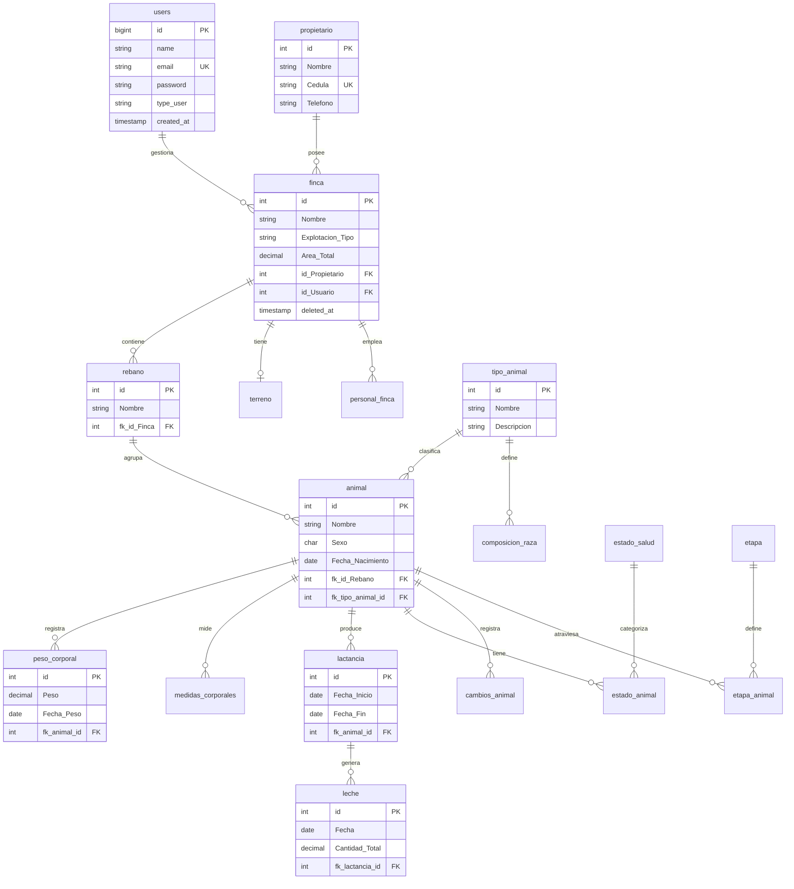
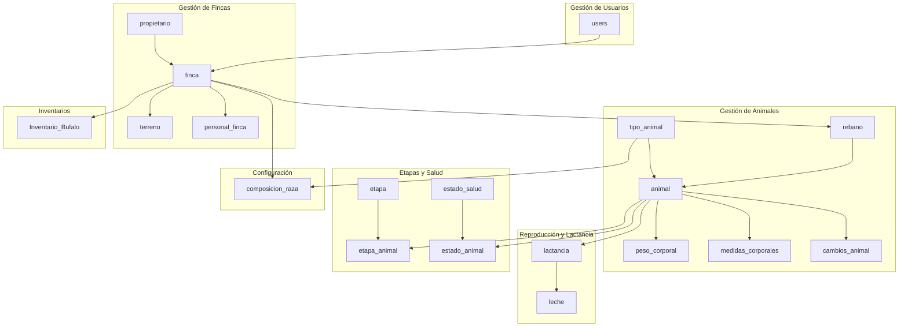
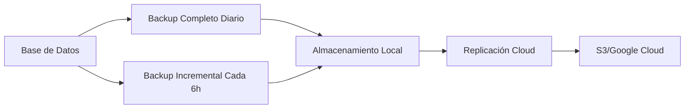

# Base de Datos

## Descripción General

GanaderaSoft utiliza **MySQL 8.0** como sistema de gestión de base de datos relacional. La estructura está diseñada para soportar la gestión completa de operaciones ganaderas, desde el registro de propietarios hasta el seguimiento detallado de cada animal.

## Características Técnicas

- **Motor de Base de Datos**: MySQL 8.0
- **Motor de Almacenamiento**: InnoDB
- **Charset**: utf8mb4
- **Collation**: utf8mb4_unicode_ci
- **Transacciones**: Soporte ACID completo

## Diagrama Entidad-Relación Principal



## Tablas Principales

### 1. Tabla `users`

**Descripción**: Almacena los usuarios del sistema con acceso a la aplicación.

| Campo | Tipo | Descripción | Restricciones |
|-------|------|-------------|---------------|
| id | BIGINT | Identificador único | PK, AUTO_INCREMENT |
| name | VARCHAR(255) | Nombre del usuario | NOT NULL |
| email | VARCHAR(255) | Correo electrónico | UNIQUE, NOT NULL |
| password | VARCHAR(255) | Contraseña hasheada | NOT NULL |
| type_user | VARCHAR(50) | Tipo de usuario | NOT NULL |
| remember_token | VARCHAR(100) | Token de sesión | NULLABLE |
| created_at | TIMESTAMP | Fecha de creación | |
| updated_at | TIMESTAMP | Fecha de actualización | |

**Índices**:
- PRIMARY KEY (id)
- UNIQUE KEY (email)

**Valores permitidos para `type_user`**:
- `admin`: Administrador del sistema
- `propietario`: Propietario de fincas
- `tecnico`: Técnico o empleado

### 2. Tabla `propietario`

**Descripción**: Información de los propietarios de las fincas.

| Campo | Tipo | Descripción | Restricciones |
|-------|------|-------------|---------------|
| id | INT | Identificador único | PK, AUTO_INCREMENT |
| Nombre | VARCHAR(100) | Nombre completo | NOT NULL |
| Cedula | VARCHAR(20) | Número de cédula | UNIQUE, NOT NULL |
| Telefono | VARCHAR(15) | Número telefónico | NULLABLE |
| created_at | TIMESTAMP | Fecha de creación | |
| updated_at | TIMESTAMP | Fecha de actualización | |

**Índices**:
- PRIMARY KEY (id)
- UNIQUE KEY (Cedula)

### 3. Tabla `finca`

**Descripción**: Registro de las fincas ganaderas.

| Campo | Tipo | Descripción | Restricciones |
|-------|------|-------------|---------------|
| id | INT | Identificador único | PK, AUTO_INCREMENT |
| Nombre | VARCHAR(100) | Nombre de la finca | NOT NULL |
| Explotacion_Tipo | VARCHAR(50) | Tipo de explotación | NOT NULL |
| Area_Total | DECIMAL(10,2) | Área en hectáreas | NULLABLE |
| Direccion | VARCHAR(255) | Dirección | NULLABLE |
| Vereda | VARCHAR(100) | Vereda | NULLABLE |
| Municipio | VARCHAR(100) | Municipio | NULLABLE |
| Departamento | VARCHAR(100) | Departamento | NULLABLE |
| id_Propietario | INT | Propietario | FK, NOT NULL |
| id_Usuario | INT | Usuario gestor | FK, NOT NULL |
| deleted_at | TIMESTAMP | Fecha de eliminación | NULLABLE |
| created_at | TIMESTAMP | Fecha de creación | |
| updated_at | TIMESTAMP | Fecha de actualización | |

**Índices**:
- PRIMARY KEY (id)
- FOREIGN KEY (id_Propietario) REFERENCES propietario(id)
- FOREIGN KEY (id_Usuario) REFERENCES users(id)
- INDEX (deleted_at) - Para soft deletes

**Valores permitidos para `Explotacion_Tipo`**:
- Intensiva
- Extensiva
- Compuesta
- Otro

### 4. Tabla `rebano`

**Descripción**: Grupos de animales dentro de una finca.

| Campo | Tipo | Descripción | Restricciones |
|-------|------|-------------|---------------|
| id | INT | Identificador único | PK, AUTO_INCREMENT |
| Nombre | VARCHAR(100) | Nombre del rebaño | NOT NULL |
| Descripcion | TEXT | Descripción | NULLABLE |
| fk_id_Finca | INT | Finca asociada | FK, NOT NULL |
| created_at | TIMESTAMP | Fecha de creación | |
| updated_at | TIMESTAMP | Fecha de actualización | |

**Índices**:
- PRIMARY KEY (id)
- FOREIGN KEY (fk_id_Finca) REFERENCES finca(id)

### 5. Tabla `tipo_animal`

**Descripción**: Catálogo de tipos de animales.

| Campo | Tipo | Descripción | Restricciones |
|-------|------|-------------|---------------|
| id | INT | Identificador único | PK, AUTO_INCREMENT |
| Nombre | VARCHAR(50) | Nombre del tipo | NOT NULL |
| Descripcion | TEXT | Descripción | NULLABLE |
| created_at | TIMESTAMP | Fecha de creación | |
| updated_at | TIMESTAMP | Fecha de actualización | |

**Ejemplos**: Búfalo, Vacuno, Caprino, Ovino

### 6. Tabla `animal`

**Descripción**: Registro individual de cada animal.

| Campo | Tipo | Descripción | Restricciones |
|-------|------|-------------|---------------|
| id | INT | Identificador único | PK, AUTO_INCREMENT |
| Nombre | VARCHAR(100) | Nombre del animal | NOT NULL |
| Sexo | CHAR(1) | Sexo del animal | NOT NULL |
| Fecha_Nacimiento | DATE | Fecha de nacimiento | NOT NULL |
| Numero_Identificacion | VARCHAR(50) | Número único | UNIQUE, NULLABLE |
| Color | VARCHAR(50) | Color | NULLABLE |
| Observaciones | TEXT | Observaciones | NULLABLE |
| fk_id_Rebano | INT | Rebaño | FK, NOT NULL |
| fk_tipo_animal_id | INT | Tipo de animal | FK, NOT NULL |
| created_at | TIMESTAMP | Fecha de creación | |
| updated_at | TIMESTAMP | Fecha de actualización | |

**Índices**:
- PRIMARY KEY (id)
- FOREIGN KEY (fk_id_Rebano) REFERENCES rebano(id)
- FOREIGN KEY (fk_tipo_animal_id) REFERENCES tipo_animal(id)
- UNIQUE KEY (Numero_Identificacion)
- INDEX (Sexo)
- INDEX (Fecha_Nacimiento)

**Valores permitidos para `Sexo`**:
- `M`: Macho
- `H`: Hembra

### 7. Tabla `peso_corporal`

**Descripción**: Registro histórico de pesos de los animales.

| Campo | Tipo | Descripción | Restricciones |
|-------|------|-------------|---------------|
| id | INT | Identificador único | PK, AUTO_INCREMENT |
| Peso | DECIMAL(8,2) | Peso en kg | NOT NULL |
| Fecha_Peso | DATE | Fecha del pesaje | NOT NULL |
| Observaciones | TEXT | Observaciones | NULLABLE |
| fk_animal_id | INT | Animal | FK, NOT NULL |
| created_at | TIMESTAMP | Fecha de creación | |

**Índices**:
- PRIMARY KEY (id)
- FOREIGN KEY (fk_animal_id) REFERENCES animal(id) ON DELETE CASCADE
- INDEX (Fecha_Peso)

### 8. Tabla `medidas_corporales`

**Descripción**: Medidas morfológicas de los animales.

| Campo | Tipo | Descripción | Restricciones |
|-------|------|-------------|---------------|
| id | INT | Identificador único | PK, AUTO_INCREMENT |
| Altura_Cruz | DECIMAL(6,2) | Altura a la cruz (cm) | NULLABLE |
| Largo_Cuerpo | DECIMAL(6,2) | Largo del cuerpo (cm) | NULLABLE |
| Perimetro_Toracico | DECIMAL(6,2) | Perímetro torácico (cm) | NULLABLE |
| Fecha_Medicion | DATE | Fecha de medición | NOT NULL |
| fk_animal_id | INT | Animal | FK, NOT NULL |
| created_at | TIMESTAMP | Fecha de creación | |

**Índices**:
- PRIMARY KEY (id)
- FOREIGN KEY (fk_animal_id) REFERENCES animal(id) ON DELETE CASCADE

### 9. Tabla `lactancia`

**Descripción**: Períodos de lactancia de las hembras.

| Campo | Tipo | Descripción | Restricciones |
|-------|------|-------------|---------------|
| id | INT | Identificador único | PK, AUTO_INCREMENT |
| Fecha_Inicio | DATE | Inicio de lactancia | NOT NULL |
| Fecha_Fin | DATE | Fin de lactancia | NULLABLE |
| Numero_Lactancia | INT | Número de lactancia | NOT NULL |
| fk_animal_id | INT | Animal (hembra) | FK, NOT NULL |
| created_at | TIMESTAMP | Fecha de creación | |
| updated_at | TIMESTAMP | Fecha de actualización | |

**Índices**:
- PRIMARY KEY (id)
- FOREIGN KEY (fk_animal_id) REFERENCES animal(id) ON DELETE CASCADE

### 10. Tabla `leche`

**Descripción**: Registro diario de producción de leche.

| Campo | Tipo | Descripción | Restricciones |
|-------|------|-------------|---------------|
| id | INT | Identificador único | PK, AUTO_INCREMENT |
| Fecha | DATE | Fecha de registro | NOT NULL |
| Cantidad_AM | DECIMAL(6,2) | Litros ordeño AM | NULLABLE |
| Cantidad_PM | DECIMAL(6,2) | Litros ordeño PM | NULLABLE |
| Cantidad_Total | DECIMAL(6,2) | Total litros | NOT NULL |
| fk_lactancia_id | INT | Lactancia | FK, NOT NULL |
| created_at | TIMESTAMP | Fecha de creación | |

**Índices**:
- PRIMARY KEY (id)
- FOREIGN KEY (fk_lactancia_id) REFERENCES lactancia(id) ON DELETE CASCADE
- INDEX (Fecha)

## Tablas de Configuración

### 11. Tabla `etapa`

**Descripción**: Etapas de vida de los animales.

| Campo | Tipo | Descripción | Restricciones |
|-------|------|-------------|---------------|
| id | INT | Identificador único | PK, AUTO_INCREMENT |
| Nombre | VARCHAR(50) | Nombre de la etapa | NOT NULL |
| Descripcion | TEXT | Descripción | NULLABLE |
| Edad_Minima_Meses | INT | Edad mínima en meses | NOT NULL |
| Edad_Maxima_Meses | INT | Edad máxima en meses | NULLABLE |
| created_at | TIMESTAMP | Fecha de creación | |
| updated_at | TIMESTAMP | Fecha de actualización | |

**Ejemplos**:
- Cría: 0-12 meses
- Juvenil: 12-24 meses
- Adulto: 24+ meses

### 12. Tabla `etapa_animal`

**Descripción**: Relación many-to-many entre animales y etapas.

| Campo | Tipo | Descripción | Restricciones |
|-------|------|-------------|---------------|
| id | INT | Identificador único | PK, AUTO_INCREMENT |
| fk_animal_id | INT | Animal | FK, NOT NULL |
| fk_etapa_id | INT | Etapa | FK, NOT NULL |
| Fecha_Inicio | DATE | Inicio de la etapa | NOT NULL |
| Fecha_Fin | DATE | Fin de la etapa | NULLABLE |
| created_at | TIMESTAMP | Fecha de creación | |

**Índices**:
- PRIMARY KEY (id)
- FOREIGN KEY (fk_animal_id) REFERENCES animal(id) ON DELETE CASCADE
- FOREIGN KEY (fk_etapa_id) REFERENCES etapa(id)

### 13. Tabla `estado_salud`

**Descripción**: Catálogo de estados de salud.

| Campo | Tipo | Descripción | Restricciones |
|-------|------|-------------|---------------|
| id | INT | Identificador único | PK, AUTO_INCREMENT |
| Nombre | VARCHAR(50) | Nombre del estado | NOT NULL |
| Descripcion | TEXT | Descripción | NULLABLE |
| created_at | TIMESTAMP | Fecha de creación | |

**Ejemplos**: Sano, Enfermo, En Tratamiento, Cuarentena

### 14. Tabla `estado_animal`

**Descripción**: Estado actual de salud del animal.

| Campo | Tipo | Descripción | Restricciones |
|-------|------|-------------|---------------|
| id | INT | Identificador único | PK, AUTO_INCREMENT |
| fk_animal_id | INT | Animal | FK, NOT NULL |
| fk_estado_salud_id | INT | Estado de salud | FK, NOT NULL |
| Fecha_Estado | DATE | Fecha del estado | NOT NULL |
| Observaciones | TEXT | Observaciones | NULLABLE |
| created_at | TIMESTAMP | Fecha de creación | |

**Índices**:
- PRIMARY KEY (id)
- FOREIGN KEY (fk_animal_id) REFERENCES animal(id) ON DELETE CASCADE
- FOREIGN KEY (fk_estado_salud_id) REFERENCES estado_salud(id)

### 15. Tabla `composicion_raza`

**Descripción**: Composiciones genéticas de razas.

| Campo | Tipo | Descripción | Restricciones |
|-------|------|-------------|---------------|
| id | INT | Identificador único | PK, AUTO_INCREMENT |
| Nombre | VARCHAR(100) | Nombre de la raza | NOT NULL |
| Porcentaje | DECIMAL(5,2) | Porcentaje (0-100) | NOT NULL |
| fk_tipo_animal_id | INT | Tipo de animal | FK, NOT NULL |
| fk_id_Finca | INT | Finca | FK, NOT NULL |
| created_at | TIMESTAMP | Fecha de creación | |
| updated_at | TIMESTAMP | Fecha de actualización | |

**Índices**:
- PRIMARY KEY (id)
- FOREIGN KEY (fk_tipo_animal_id) REFERENCES tipo_animal(id)
- FOREIGN KEY (fk_id_Finca) REFERENCES finca(id)

## Tablas Complementarias

### 16. Tabla `terreno`

**Descripción**: Características del terreno de cada finca.

| Campo | Tipo | Descripción | Restricciones |
|-------|------|-------------|---------------|
| id | INT | Identificador único | PK, AUTO_INCREMENT |
| Area_Total | DECIMAL(10,2) | Área total (ha) | NULLABLE |
| Tipo_Relieve | VARCHAR(50) | Tipo de relieve | NULLABLE |
| pH_Suelo | VARCHAR(20) | pH del suelo | NULLABLE |
| Textura_Suelo | VARCHAR(50) | Textura del suelo | NULLABLE |
| Metodo_Riego | VARCHAR(50) | Método de riego | NULLABLE |
| Fuente_Agua | VARCHAR(50) | Fuente de agua | NULLABLE |
| fk_id_Finca | INT | Finca | FK, UNIQUE, NOT NULL |
| created_at | TIMESTAMP | Fecha de creación | |
| updated_at | TIMESTAMP | Fecha de actualización | |

**Índices**:
- PRIMARY KEY (id)
- FOREIGN KEY (fk_id_Finca) REFERENCES finca(id)
- UNIQUE KEY (fk_id_Finca)

### 17. Tabla `personal_finca`

**Descripción**: Personal que trabaja en las fincas.

| Campo | Tipo | Descripción | Restricciones |
|-------|------|-------------|---------------|
| id | INT | Identificador único | PK, AUTO_INCREMENT |
| Nombre | VARCHAR(100) | Nombre completo | NOT NULL |
| Cedula | VARCHAR(20) | Número de cédula | UNIQUE, NOT NULL |
| Cargo | VARCHAR(50) | Cargo o función | NOT NULL |
| Telefono | VARCHAR(15) | Teléfono | NULLABLE |
| fk_id_Finca | INT | Finca | FK, NOT NULL |
| created_at | TIMESTAMP | Fecha de creación | |
| updated_at | TIMESTAMP | Fecha de actualización | |

**Índices**:
- PRIMARY KEY (id)
- FOREIGN KEY (fk_id_Finca) REFERENCES finca(id)
- UNIQUE KEY (Cedula)

### 18. Tabla `cambios_animal`

**Descripción**: Registro de cambios importantes en animales.

| Campo | Tipo | Descripción | Restricciones |
|-------|------|-------------|---------------|
| id | INT | Identificador único | PK, AUTO_INCREMENT |
| fk_animal_id | INT | Animal | FK, NOT NULL |
| Tipo_Cambio | VARCHAR(50) | Tipo de cambio | NOT NULL |
| Fecha_Cambio | DATE | Fecha del cambio | NOT NULL |
| Descripcion | TEXT | Descripción | NULLABLE |
| Observaciones | TEXT | Observaciones | NULLABLE |
| created_at | TIMESTAMP | Fecha de creación | |

**Índices**:
- PRIMARY KEY (id)
- FOREIGN KEY (fk_animal_id) REFERENCES animal(id) ON DELETE CASCADE
- INDEX (Fecha_Cambio)

**Tipos de cambio**: Cambio de rebaño, Venta, Compra, Muerte, Cambio de estado

### 19. Tabla `Inventario_Bufalo`

**Descripción**: Inventarios de búfalos por categoría.

| Campo | Tipo | Descripción | Restricciones |
|-------|------|-------------|---------------|
| id | INT | Identificador único | PK, AUTO_INCREMENT |
| fk_id_Finca | INT | Finca | FK, NOT NULL |
| Fecha_Inventario | DATE | Fecha del inventario | NOT NULL |
| Machos_0_12_meses | INT | Machos 0-12 meses | DEFAULT 0 |
| Machos_12_24_meses | INT | Machos 12-24 meses | DEFAULT 0 |
| Machos_24_mas_meses | INT | Machos 24+ meses | DEFAULT 0 |
| Hembras_0_12_meses | INT | Hembras 0-12 meses | DEFAULT 0 |
| Hembras_12_24_meses | INT | Hembras 12-24 meses | DEFAULT 0 |
| Hembras_24_mas_meses | INT | Hembras 24+ meses | DEFAULT 0 |
| Total_Animales | INT | Total animales | DEFAULT 0 |
| created_at | TIMESTAMP | Fecha de creación | |

**Índices**:
- PRIMARY KEY (id)
- FOREIGN KEY (fk_id_Finca) REFERENCES finca(id)
- INDEX (Fecha_Inventario)

## Tablas del Sistema

### 20. Tabla `personal_access_tokens`

**Descripción**: Tokens de autenticación de Laravel Sanctum.

| Campo | Tipo | Descripción | Restricciones |
|-------|------|-------------|---------------|
| id | BIGINT | Identificador único | PK, AUTO_INCREMENT |
| tokenable_type | VARCHAR(255) | Tipo de modelo | NOT NULL |
| tokenable_id | BIGINT | ID del modelo | NOT NULL |
| name | VARCHAR(255) | Nombre del token | NOT NULL |
| token | VARCHAR(64) | Token hasheado | UNIQUE, NOT NULL |
| abilities | TEXT | Permisos | NULLABLE |
| last_used_at | TIMESTAMP | Último uso | NULLABLE |
| expires_at | TIMESTAMP | Fecha de expiración | NULLABLE |
| created_at | TIMESTAMP | Fecha de creación | |
| updated_at | TIMESTAMP | Fecha de actualización | |

**Índices**:
- PRIMARY KEY (id)
- UNIQUE KEY (token)
- INDEX (tokenable_type, tokenable_id)

### 21. Tabla `migrations`

**Descripción**: Control de migraciones de Laravel.

### 22. Tabla `failed_jobs`

**Descripción**: Trabajos fallidos de Laravel Queue.

## Diagrama de Relaciones Completo



## Índices y Optimizaciones

### Índices Recomendados

1. **Búsquedas Frecuentes**:
   - `animal(Sexo, Fecha_Nacimiento)`
   - `finca(id_Usuario, deleted_at)`
   - `rebano(fk_id_Finca)`

2. **Relaciones FK**:
   - Todos los campos de foreign keys tienen índices

3. **Soft Deletes**:
   - `finca(deleted_at)`

### Estrategias de Optimización

1. **Particionamiento**: Considerar particionamiento por año en tablas históricas (`leche`, `peso_corporal`)
2. **Archivado**: Mover datos antiguos a tablas de archivo
3. **Índices Compuestos**: Para queries complejos frecuentes
4. **Caché de Queries**: Implementar caché Redis para consultas costosas

## Backup y Mantenimiento

### Estrategia de Backup



### Mantenimiento

- **Análisis de Tablas**: Mensual
- **Optimización de Índices**: Trimestral
- **Limpieza de Logs**: Semanal
- **Verificación de Integridad**: Diario

## Migraciones de Laravel

Las migraciones están organizadas en orden cronológico:

```
database/migrations/
├── 2014_10_12_000000_create_users_table.php
├── 2019_12_14_000001_create_personal_access_tokens_table.php
└── [otras migraciones específicas del dominio]
```

### Ejecutar Migraciones

```bash
# Ejecutar migraciones pendientes
php artisan migrate

# Revertir última migración
php artisan migrate:rollback

# Refrescar base de datos (desarrollo)
php artisan migrate:fresh --seed
```

## Seeders

Los seeders poblan la base de datos con datos de prueba:

```bash
# Ejecutar todos los seeders
php artisan db:seed

# Ejecutar seeder específico
php artisan db:seed --class=UserSeeder
```

## Consideraciones de Seguridad

1. **SQL Injection**: Prevenido mediante Eloquent ORM
2. **Passwords**: Hash con bcrypt
3. **Tokens**: Hash SHA-256 en `personal_access_tokens`
4. **Permisos**: Usuario MySQL con permisos mínimos necesarios
5. **Backups**: Encriptados antes de almacenamiento

## Tamaño y Crecimiento Estimado

| Tabla | Registros/Año | Tamaño Estimado |
|-------|---------------|-----------------|
| animal | 500 | 50 KB |
| peso_corporal | 6,000 | 600 KB |
| leche | 180,000 | 18 MB |
| medidas_corporales | 1,500 | 150 KB |
| finca | 50 | 5 KB |

**Total estimado anual**: ~20 MB de datos transaccionales

---

**Última actualización:** Octubre 2025  
**Motor de Base de Datos**: MySQL 8.0  
**Total de Tablas**: 51  
**Mantenido por:** Equipo de Desarrollo GanaderaSoft
