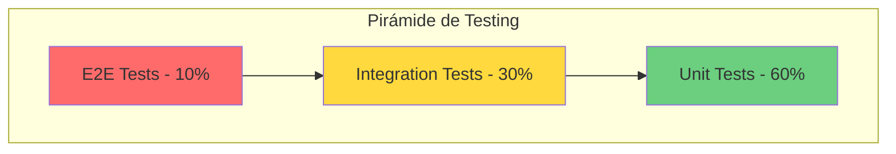

# Testing

## Descripción General

GanaderaSoft implementa una estrategia de testing integral utilizando **PHPUnit 10.1** como framework principal. Los tests garantizan la calidad del código, previenen regresiones y documentan el comportamiento esperado del sistema.

## Estrategia de Testing

### Pirámide de Testing



### Tipos de Tests Implementados

1. **Unit Tests (60%)**: Prueban componentes individuales (modelos, servicios)
2. **Feature Tests (30%)**: Prueban endpoints completos de la API
3. **Integration Tests (10%)**: Prueban interacciones entre componentes

## Estructura de Testing

### Organización de Directorios

```
tests/
├── Feature/                    # Feature tests (API endpoints)
│   ├── ExampleTest.php
│   ├── AuthTest.php (futuro)
│   ├── FincaTest.php (futuro)
│   └── AnimalTest.php (futuro)
├── Unit/                       # Unit tests (modelos, servicios)
│   ├── Models/
│   │   └── ...
│   ├── PesoCorporalRelationshipTest.php
│   ├── MedidasCorporalesRelationshipTest.php
│   └── ExampleTest.php
├── TestCase.php               # Base test class
└── CreatesApplication.php     # Application bootstrap para tests
```

### Configuración de PHPUnit

**Archivo**: `phpunit.xml`

```xml
<phpunit>
    <testsuites>
        <testsuite name="Unit">
            <directory>tests/Unit</directory>
        </testsuite>
        <testsuite name="Feature">
            <directory>tests/Feature</directory>
        </testsuite>
    </testsuites>
    
    <php>
        <env name="APP_ENV" value="testing"/>
        <env name="BCRYPT_ROUNDS" value="4"/>
        <env name="CACHE_DRIVER" value="array"/>
        <env name="DB_CONNECTION" value="sqlite"/>
        <env name="DB_DATABASE" value=":memory:"/>
        <env name="QUEUE_CONNECTION" value="sync"/>
    </php>
</phpunit>
```

## Unit Tests

### Descripción

Los unit tests prueban componentes individuales de forma aislada, sin dependencias externas.

### Ejemplos Implementados

#### Test de Relaciones en Modelos

**Archivo**: `tests/Unit/PesoCorporalRelationshipTest.php`

```php
<?php

namespace Tests\Unit;

use Tests\TestCase;
use App\Models\Animal;
use App\Models\PesoCorporal;

class PesoCorporalRelationshipTest extends TestCase
{
    public function test_animal_has_many_peso_corporal()
    {
        $animal = Animal::factory()->create();
        $peso = PesoCorporal::factory()->create([
            'fk_animal_id' => $animal->id
        ]);
        
        $this->assertTrue($animal->pesosCorporales->contains($peso));
    }
    
    public function test_peso_corporal_belongs_to_animal()
    {
        $peso = PesoCorporal::factory()->create();
        
        $this->assertInstanceOf(Animal::class, $peso->animal);
    }
}
```

### Casos de Prueba para Unit Tests

1. **Modelos**:
   - Validación de atributos
   - Relaciones entre modelos
   - Scopes personalizados
   - Mutators y accessors

2. **Servicios**:
   - Lógica de negocio
   - Cálculos
   - Transformaciones de datos

### Ejecutar Unit Tests

```bash
# Ejecutar todos los unit tests
php artisan test --testsuite=Unit

# Ejecutar un archivo específico
php artisan test tests/Unit/PesoCorporalRelationshipTest.php

# Con cobertura de código
php artisan test --coverage
```

## Feature Tests

### Descripción

Los feature tests prueban funcionalidades completas, simulando requests HTTP a la API.

### Estructura de un Feature Test

```php
<?php

namespace Tests\Feature;

use Tests\TestCase;
use App\Models\User;
use Illuminate\Foundation\Testing\RefreshDatabase;

class AuthTest extends TestCase
{
    use RefreshDatabase;
    
    public function test_user_can_register()
    {
        $response = $this->postJson('/api/auth/register', [
            'name' => 'Test User',
            'email' => 'test@example.com',
            'password' => 'password123',
            'password_confirmation' => 'password123',
            'type_user' => 'propietario'
        ]);
        
        $response->assertStatus(201)
                 ->assertJsonStructure([
                     'success',
                     'message',
                     'data' => [
                         'user',
                         'token',
                         'token_type'
                     ]
                 ]);
                 
        $this->assertDatabaseHas('users', [
            'email' => 'test@example.com'
        ]);
    }
    
    public function test_user_can_login()
    {
        $user = User::factory()->create([
            'password' => bcrypt('password123')
        ]);
        
        $response = $this->postJson('/api/auth/login', [
            'email' => $user->email,
            'password' => 'password123'
        ]);
        
        $response->assertStatus(200)
                 ->assertJsonStructure([
                     'success',
                     'data' => ['token']
                 ]);
    }
    
    public function test_authenticated_user_can_access_profile()
    {
        $user = User::factory()->create();
        
        $response = $this->actingAs($user)
                         ->getJson('/api/profile');
        
        $response->assertStatus(200)
                 ->assertJson([
                     'success' => true
                 ]);
    }
}
```

### Casos de Prueba para Feature Tests

#### 1. Autenticación

```php
// tests/Feature/AuthTest.php
- test_user_can_register()
- test_registration_fails_with_invalid_data()
- test_registration_fails_with_duplicate_email()
- test_user_can_login()
- test_login_fails_with_invalid_credentials()
- test_authenticated_user_can_logout()
- test_authenticated_user_can_access_profile()
```

#### 2. Gestión de Fincas

```php
// tests/Feature/FincaTest.php
- test_authenticated_user_can_create_finca()
- test_creation_fails_without_required_fields()
- test_user_can_list_their_fincas()
- test_user_can_view_single_finca()
- test_user_can_update_finca()
- test_user_can_delete_finca() // soft delete
- test_user_cannot_access_other_users_finca()
```

#### 3. Gestión de Animales

```php
// tests/Feature/AnimalTest.php
- test_user_can_create_animal()
- test_animal_creation_validates_required_fields()
- test_user_can_list_animals()
- test_user_can_filter_animals_by_rebano()
- test_user_can_filter_animals_by_sexo()
- test_user_can_add_peso_to_animal()
- test_user_can_add_medidas_to_animal()
- test_user_can_record_lactancia()
```

### Ejecutar Feature Tests

```bash
# Ejecutar todos los feature tests
php artisan test --testsuite=Feature

# Ejecutar con output detallado
php artisan test --testsuite=Feature --verbose

# Ejecutar un test específico
php artisan test --filter test_user_can_register
```

## Integration Tests

### Descripción

Prueban la interacción entre múltiples componentes del sistema.

### Ejemplo de Integration Test

```php
<?php

namespace Tests\Feature;

use Tests\TestCase;
use App\Models\User;
use App\Models\Finca;
use App\Models\Rebano;
use App\Models\Animal;
use Illuminate\Foundation\Testing\RefreshDatabase;

class AnimalCreationFlowTest extends TestCase
{
    use RefreshDatabase;
    
    public function test_complete_animal_creation_flow()
    {
        // 1. Crear usuario
        $user = User::factory()->create();
        
        // 2. Crear finca
        $finca = Finca::factory()->create([
            'id_Usuario' => $user->id
        ]);
        
        // 3. Crear rebaño
        $rebano = Rebano::factory()->create([
            'fk_id_Finca' => $finca->id
        ]);
        
        // 4. Crear animal via API
        $response = $this->actingAs($user)->postJson('/api/animales', [
            'Nombre' => 'Luna',
            'Sexo' => 'H',
            'Fecha_Nacimiento' => '2023-01-15',
            'fk_id_Rebano' => $rebano->id,
            'fk_tipo_animal_id' => 1
        ]);
        
        $response->assertStatus(201);
        
        // 5. Verificar que el animal está en la base de datos
        $this->assertDatabaseHas('animal', [
            'Nombre' => 'Luna',
            'fk_id_Rebano' => $rebano->id
        ]);
        
        // 6. Verificar que el animal pertenece al rebaño
        $animal = Animal::where('Nombre', 'Luna')->first();
        $this->assertEquals($rebano->id, $animal->rebano->id);
        $this->assertEquals($finca->id, $animal->rebano->finca->id);
    }
}
```

## Testing de API con Postman

### Colección de Tests

**Ubicación**: `docs/GanaderaSoft-API-Complete.postman_collection.json`

La colección incluye tests automatizados para cada endpoint:

```javascript
// Ejemplo de test en Postman
pm.test("Status code is 200", function () {
    pm.response.to.have.status(200);
});

pm.test("Response has success field", function () {
    var jsonData = pm.response.json();
    pm.expect(jsonData).to.have.property('success');
    pm.expect(jsonData.success).to.be.true;
});

pm.test("Response has data field", function () {
    var jsonData = pm.response.json();
    pm.expect(jsonData).to.have.property('data');
});
```

### Ejecutar Tests de Postman

```bash
# Usando Newman (CLI de Postman)
newman run docs/GanaderaSoft-API-Complete.postman_collection.json \
  --environment docs/GanaderaSoft-Environment.postman_environment.json
```

## Database Testing

### Factories

Las factories generan datos de prueba realistas:

**Ejemplo**: `database/factories/AnimalFactory.php`

```php
<?php

namespace Database\Factories;

use App\Models\Animal;
use App\Models\Rebano;
use App\Models\TipoAnimal;
use Illuminate\Database\Eloquent\Factories\Factory;

class AnimalFactory extends Factory
{
    protected $model = Animal::class;
    
    public function definition(): array
    {
        return [
            'Nombre' => $this->faker->firstName(),
            'Sexo' => $this->faker->randomElement(['M', 'H']),
            'Fecha_Nacimiento' => $this->faker->date(),
            'Numero_Identificacion' => $this->faker->unique()->numerify('AN####'),
            'Color' => $this->faker->colorName(),
            'fk_id_Rebano' => Rebano::factory(),
            'fk_tipo_animal_id' => TipoAnimal::factory(),
        ];
    }
}
```

### Seeders para Testing

```php
<?php

namespace Database\Seeders;

use Illuminate\Database\Seeder;
use App\Models\User;
use App\Models\Finca;
use App\Models\Animal;

class TestDataSeeder extends Seeder
{
    public function run(): void
    {
        // Crear usuario de prueba
        $user = User::factory()->create([
            'email' => 'test@ganaderasoft.com',
            'type_user' => 'admin'
        ]);
        
        // Crear fincas de prueba
        Finca::factory()
            ->count(5)
            ->create(['id_Usuario' => $user->id]);
        
        // Crear animales de prueba
        Animal::factory()->count(50)->create();
    }
}
```

### RefreshDatabase Trait

```php
use Illuminate\Foundation\Testing\RefreshDatabase;

class ExampleTest extends TestCase
{
    use RefreshDatabase;
    
    // La base de datos se resetea antes de cada test
}
```

## Mocking y Stubbing

### Mocking de Dependencias Externas

```php
use Mockery;
use App\Services\ExternalApiService;

public function test_service_handles_external_api_failure()
{
    // Crear mock del servicio
    $mock = Mockery::mock(ExternalApiService::class);
    
    // Definir comportamiento esperado
    $mock->shouldReceive('fetchData')
         ->once()
         ->andReturn(null);
    
    // Inyectar mock en el contenedor
    $this->app->instance(ExternalApiService::class, $mock);
    
    // Ejecutar test
    // ...
}
```

## Cobertura de Código

### Generar Reporte de Cobertura

```bash
# Generar cobertura en HTML
php artisan test --coverage-html coverage

# Generar cobertura en texto
php artisan test --coverage-text

# Verificar cobertura mínima
php artisan test --coverage --min=80
```

### Objetivos de Cobertura

| Tipo | Objetivo |
|------|----------|
| Total | > 80% |
| Controllers | > 90% |
| Models | > 85% |
| Services | > 90% |

## Continuous Integration

### GitHub Actions (Futuro)

```yaml
# .github/workflows/tests.yml
name: Tests

on: [push, pull_request]

jobs:
  test:
    runs-on: ubuntu-latest
    
    steps:
      - uses: actions/checkout@v2
      
      - name: Setup PHP
        uses: shivammathur/setup-php@v2
        with:
          php-version: 8.1
          extensions: mbstring, pdo, pdo_mysql
          
      - name: Install Dependencies
        run: composer install
        
      - name: Run Tests
        run: php artisan test --coverage
        
      - name: Upload Coverage
        uses: codecov/codecov-action@v2
```

## Buenas Prácticas

### 1. Nomenclatura de Tests

```php
// ✅ Bueno: Descriptivo y claro
test_user_can_create_finca_with_valid_data()
test_creation_fails_when_propietario_does_not_exist()

// ❌ Malo: No descriptivo
test1()
testFinca()
```

### 2. Arrange-Act-Assert (AAA)

```php
public function test_user_can_update_animal()
{
    // Arrange: Preparar datos
    $user = User::factory()->create();
    $animal = Animal::factory()->create();
    
    // Act: Ejecutar acción
    $response = $this->actingAs($user)
                     ->putJson("/api/animales/{$animal->id}", [
                         'Nombre' => 'Nuevo Nombre'
                     ]);
    
    // Assert: Verificar resultado
    $response->assertStatus(200);
    $this->assertEquals('Nuevo Nombre', $animal->fresh()->Nombre);
}
```

### 3. Un Test, Una Aserción (cuando sea posible)

```php
// ✅ Bueno: Foco específico
public function test_animal_nombre_is_required()
{
    $response = $this->postJson('/api/animales', []);
    
    $response->assertStatus(422)
             ->assertJsonValidationErrors(['Nombre']);
}

// ⚠️ Aceptable: Múltiples aserciones relacionadas
public function test_animal_is_created_with_valid_data()
{
    $response = $this->postJson('/api/animales', $validData);
    
    $response->assertStatus(201);
    $this->assertDatabaseHas('animal', ['Nombre' => 'Luna']);
}
```

### 4. Usar Factories en lugar de Crear Registros Manualmente

```php
// ✅ Bueno
$finca = Finca::factory()->create();

// ❌ Malo
$finca = Finca::create([
    'Nombre' => 'Test',
    'Explotacion_Tipo' => 'Intensiva',
    // ... muchos campos más
]);
```

### 5. Tests Independientes

```php
// ✅ Bueno: Cada test es independiente
public function test_feature_a()
{
    $user = User::factory()->create();
    // test específico
}

public function test_feature_b()
{
    $user = User::factory()->create();
    // otro test específico
}

// ❌ Malo: Tests dependientes
protected $user;

public function test_feature_a()
{
    $this->user = User::factory()->create();
}

public function test_feature_b()
{
    // depende de test_feature_a
    $this->user->doSomething();
}
```

## Comandos Útiles

```bash
# Ejecutar todos los tests
php artisan test

# Ejecutar un testsuite específico
php artisan test --testsuite=Feature

# Ejecutar un archivo específico
php artisan test tests/Feature/AuthTest.php

# Ejecutar un test específico
php artisan test --filter test_user_can_login

# Tests con output detallado
php artisan test --verbose

# Detener en el primer fallo
php artisan test --stop-on-failure

# Parallel testing (más rápido)
php artisan test --parallel

# Con cobertura
php artisan test --coverage
php artisan test --coverage-html coverage/

# Ejecutar solo los tests que fallaron
php artisan test --failed
```

## Testing Checklist

### Antes de Hacer Commit

- [ ] Todos los tests pasan localmente
- [ ] Se agregaron tests para nuevas funcionalidades
- [ ] Tests existentes siguen funcionando
- [ ] Cobertura de código > 80%
- [ ] No hay warnings ni deprecations

### Antes de Hacer Deploy

- [ ] Tests de CI/CD pasan
- [ ] Tests de integración pasan
- [ ] Tests de Postman pasan
- [ ] Performance tests aceptables
- [ ] Tests de seguridad pasan

## Roadmap de Testing

### Implementaciones Futuras

1. **Mutation Testing**
   - Implementar PHPUnit Infection
   - Mejorar calidad de tests

2. **E2E Testing**
   - Implementar Laravel Dusk
   - Tests de navegador automatizados

3. **Performance Testing**
   - Apache JMeter
   - Load testing de API

4. **Security Testing**
   - OWASP ZAP
   - Análisis de vulnerabilidades

5. **Visual Regression Testing**
   - Percy o BackstopJS
   - Tests de componentes visuales

## Recursos Adicionales

- [PHPUnit Documentation](https://phpunit.de/documentation.html)
- [Laravel Testing](https://laravel.com/docs/10.x/testing)
- [Test-Driven Development](https://martinfowler.com/bliki/TestDrivenDevelopment.html)

---

**Última actualización:** Octubre 2025  
**Framework de Testing**: PHPUnit 10.1  
**Cobertura Objetivo**: > 80%  
**Mantenido por:** Equipo de Desarrollo GanaderaSoft
